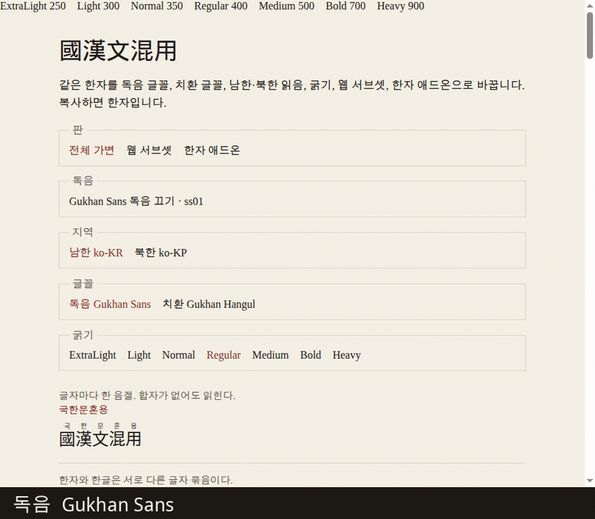

# 국한문 / Gukhanmun

한자는 그대로 두고, 독음을 위에 그리거나 그 한자를 한글로 바꿔 보여주는 글꼴입니다.



[라이브 데모](https://moreal.github.io/gukhanmun-font/) · [놀이터](https://moreal.github.io/gukhanmun-font/playground/) · [릴리스](https://github.com/moreal/gukhanmun-font/releases)

## 내려받기

폰트 패밀리마다 zip이 하나 있습니다. `GukhanmunSans`, `GukhanmunSansKP`, `GukhanmunHangul`, `GukhanmunHangulKP`. 정적 일곱 굵기, 가변 폰트, 웹 서브셋, 한자 애드온, `hanja.css`, `SHA256SUMS.txt`가 들어 있습니다.

## 쓰는 법

```html
<p class="ruby">國漢文混用으로 쓴 大韓民國.</p>
<style>
  @font-face {
    font-family: "Gukhanmun Sans";
    src: url("GukhanmunSans-Regular.woff2") format("woff2");
    font-weight: 400;
  }
  .ruby { font-family: "Gukhanmun Sans", sans-serif; line-height: 2; }
</style>
```

한자만 다른 한글 글꼴 위에 얹을 때는 애드온을 `font-family` 맨 앞에 둡니다. `unicode-range` 전체는 zip 안의 `hanja.css`입니다.

```html
<p class="gukhanmun-hanja">女子와 男女, 平壤 冷麵.</p>
<style>
  @font-face {
    font-family: "Gukhanmun Sans Hanja";
    src: url("GukhanmunSansHanja-Regular.woff2") format("woff2");
    font-weight: 400;
    unicode-range: /* hanja.css */;
    ascent-override: 158%;
    descent-override: 28.8%;
    line-gap-override: 0%;
  }
  .gukhanmun-hanja {
    font-family: "Gukhanmun Sans Hanja", "Pretendard", sans-serif;
    line-height: 2;
  }
</style>
```

한글 글꼴에도 애드온과 같은 `ascent-override`, `descent-override`, `line-gap-override`를 주세요. 독음은 158%, 치환은 116%라서 폰트 패밀리를 둘로 나눕니다. 예는 [안내](docs/guide.md)의 「본문 글꼴의 메트릭」에 있습니다.

독음 끄기(`ss01`)는 독음을 다는 폰트의 독음만 끕니다. CSS에서는 `font-feature-settings: "ss01"`입니다. 가변 폰트의 기본 인스턴스는 ExtraLight라서, 굵기를 지정합니다.

## 빌드

Node.js 22.14 이상, pnpm 10.33, Python 3의 fontTools 4.67.0.

```sh
pnpm install
python3 -m pip install --user fonttools==4.67.0
pnpm test
pnpm build
pnpm build:pages
pnpm demo
```

동작, 측정값, 라이선스 출처는 [안내](docs/guide.md)에 있습니다. 릴리스 태그는 `v2026.10.17`처럼 `vYYYY.MM.DD`입니다.

## 라이선스

| | |
| --- | --- |
| 코드 | [MIT](LICENSE) |
| 글꼴 | [SIL OFL 1.1](OFL.txt). [본고딕(Adobe Source Han Sans KR)](https://github.com/adobe-fonts/source-han-sans)을 바탕으로 만들었지만, OFL 조건에 따라 원본의 예약 글꼴 이름인 Source는 쓰지 않습니다. |
| `vendor/furifont/` | [MIT](vendor/furifont/LICENSE.md), Anthony Fu, furifont 0.5.1 |
| 남한 사전 표 | [CC BY-SA 4.0](LICENSES/CC-BY-SA-4.0.txt) |
| 북한 사전 표 | [CC BY-SA 2.0 KR](https://creativecommons.org/licenses/by-sa/2.0/kr/) |
| Unihan | [Unicode License](LICENSES/Unicode-License.txt) |
| 데모의 Gothic A1 | SIL OFL 1.1. 예약된 이름은 Gothic A1. |
