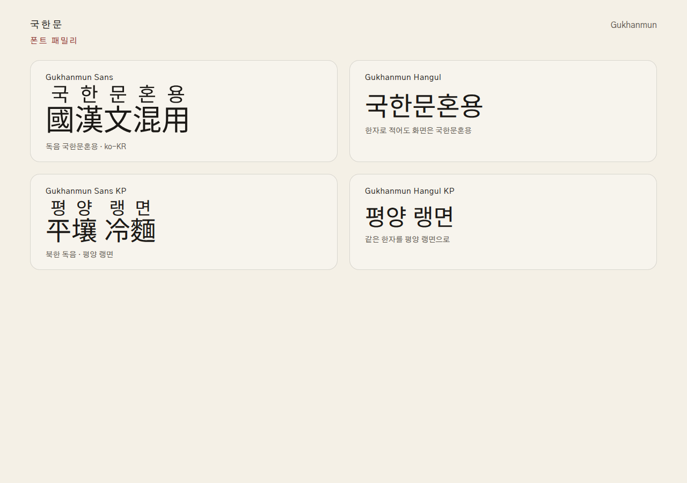
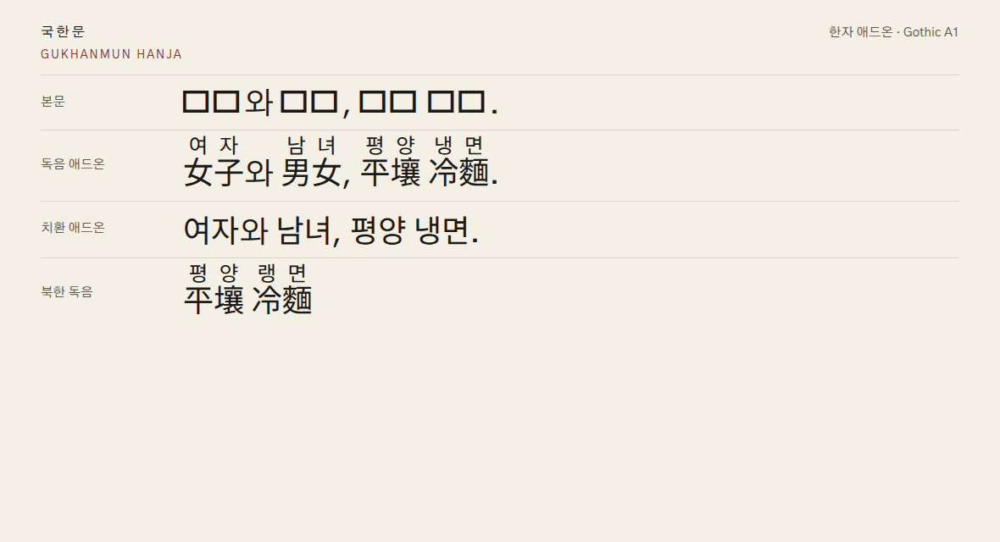

# 국한문 안내

이 문서는 측정값, 메트릭, 빌드, 라이선스 출처를 담습니다. 짧은 사용법은 저장소 [README](../README.md)에 있고, 동작은 [라이브 페이지](https://moreal.github.io/gukhanmun-font/)와 [놀이터](https://moreal.github.io/gukhanmun-font/playground/)가 설명합니다.

한자는 그대로 두고 독음을 붙이는 글꼴입니다. `國漢文混用`이라고만 적습니다. `<ruby>`도, 자바스크립트도 필요 없고, 복사하면 한자 그대로입니다.

- **Gukhanmun Sans**는 한글 독음 `국한문혼용`을 한자 위에 그립니다.
- **Gukhanmun Hangul**은 그 한자를 독음으로 바꿉니다. 화면에는 `국한문혼용`만 보입니다.
- 지역은 **ko-KR**(남한, 두음 법칙)과 **ko-KP**(북한, 두음 법칙 없음)입니다. 폰트 패밀리 이름이 다릅니다.
- 굵기는 ExtraLight부터 Heavy까지이고, 독음이 굵기를 따라가는 가변 폰트가 있습니다.
- **웹 서브셋**은 Regular 한 파일이고, 한글·라틴과 KS X 1001 한자를 담습니다.
- **한자 애드온**은 한자만 담습니다. `unicode-range`로 다른 한글 글꼴 위에 얹습니다.

Two families, two regions. Gukhanmun Sans draws the Hangul above the Hanja. Gukhanmun Hangul replaces the Hanja with that reading. Copy, paste, and search still see the Hanja. A variable font follows the weight axis, a Regular web subset drops most of the Hanja outside KS X 1001, and a Hanja-only add-on is meant to sit in front of any other Korean font.



한자 애드온을 Gothic A1 위에 얹은 모습입니다. 첫 줄은 Gothic A1이라 한자가 빈 상자입니다. 운영체제에 다른 한자 글꼴이 있으면 브라우저가 그 글자로 빈칸을 채웁니다. 데모는 그 한자를 빈 상자로 받는 `Hanja Box`를 뒤에 둡니다. 아래 줄은 애드온이 한자만 그리고, `와` 같은 한글은 Gothic A1이 그립니다. 넷째 줄의 `冷`은 북한 독음 `랭`입니다.



## 쓰는 법

```html
<p class="ruby">國漢文混用으로 쓴 大韓民國.</p>
<p class="hangul">國漢文混用으로 쓴 大韓民國.</p>
<style>
  @font-face {
    font-family: "Gukhanmun Sans";
    src: url("GukhanmunSans-Regular.woff2") format("woff2");
    font-weight: 400;
  }
  @font-face {
    font-family: "Gukhanmun Hangul";
    src: url("GukhanmunHangul-Regular.woff2") format("woff2");
    font-weight: 400;
  }
  .ruby { font-family: "Gukhanmun Sans", sans-serif; line-height: 2; }
  .hangul { font-family: "Gukhanmun Hangul", sans-serif; }
</style>
```

Gukhanmun Sans는 `line-height`를 2로 둡니다. 독음은 전각 상자 위에 그려지므로, 줄 간격이 좁으면 잘립니다. 독음은 기본으로 켜져 있습니다. 독음 끄기(`ss01`)를 CSS에서 `font-feature-settings: "ss01" 1`로 켜면 독음만 사라지고 한자는 그대로 남습니다. Gukhanmun Hangul에는 그 스위치가 없습니다. 한자가 이미 한글로 바뀌어 있습니다.

굵기 파일은 `GukhanmunSans-ExtraLight.woff2`부터 `GukhanmunSans-Heavy.woff2`까지입니다. CSS `font-weight`는 250, 300, 350, 400, 500, 700, 900입니다. 가변 폰트의 폰트 패밀리는 `Gukhanmun Sans VF`이고 `font-weight: 250 900`입니다. 기본 인스턴스가 ExtraLight라서, 페이지에서는 굵기 400을 지정합니다. 웹 서브셋의 폰트 패밀리는 `Gukhanmun Sans Web`이고 Regular 하나입니다. 북한 글꼴은 이름에 `KP`가 붙습니다. `Gukhanmun Sans KP`, `Gukhanmun Sans KP VF`, `Gukhanmun Sans KP Web`.

Set `line-height: 2` for Gukhanmun Sans so the reading is not clipped. 독음 끄기 (`ss01`) turns that family's readings off with `font-feature-settings: "ss01" 1`. Variable families are named `Gukhanmun Sans VF` (and `Gukhanmun Hangul VF`, plus `KP` for the north). The default instance is ExtraLight, so set an explicit weight.

## 한자 애드온

한자 애드온은 독음에 필요한 것만 담습니다. 매핑된 문자는 한자뿐입니다. 그 한자의 독음 글리프, 단어 합자, 두음 법칙으로 달라지는 어두 형태가 글꼴 안에 있고, cmap에는 없습니다. `.notdef`는 남깁니다. 한글이나 라틴을 이 글꼴이 그리지 않으므로, 본문 글꼴이 그립니다.

빌드가 `dist/hanja.css`를 만듭니다. 릴리스 zip마다 그 폰트 패밀리와 지역만 담은 `hanja.css`도 들어 있습니다. `unicode-range`는 실제로 들어 있는 8,497자를 이어 붙인 목록입니다. 블록 전체를 적으면, 글꼴에 없는 한자까지 이 글꼴이 맡아 빈 칸(tofu)이 됩니다. 빠진 한자는 다음 글꼴로 넘어가야 하므로, 목록은 글꼴의 cmap과 같습니다.

들어 있는 한자: CJK Unified Ideographs 8,004자, Extension A 92자, Compatibility Ideographs 330자, Extension B 56자, Extension E 2자, Extension F 1자, Compatibility Ideographs Supplement 12자. 남한과 북한이 맡는 한자 집합은 같습니다. 독음만 다릅니다. 독음이 없는 한자 155자는 일부러 빼서 본문 글꼴에 맡깁니다.

```html
<p class="gukhanmun-hanja">女子와 男女, 平壤 冷麵.</p>
<style>
  /* 전체 목록은 dist/hanja.css 에 있습니다. 아래 unicode-range 는 그 파일의 값으로 바꿉니다. */
  @font-face {
    font-family: "Gukhanmun Sans Hanja";
    src: url("GukhanmunSansHanja-Regular.woff2") format("woff2");
    font-weight: 400;
    font-display: swap;
    unicode-range: U+349A, U+4E00-4E01, U+4E03, /* … cmap 과 같은 8,497자 … */ U+2F9DF;
    ascent-override: 158%;
    descent-override: 28.8%;
    line-gap-override: 0%;
    size-adjust: 100%;
  }
  .gukhanmun-hanja {
    font-family: "Gukhanmun Sans Hanja", "Pretendard", sans-serif;
    line-height: 2;
  }
</style>
```

`font-family: "Gukhanmun Sans Hanja", "Pretendard", sans-serif`처럼 애드온을 맨 앞에 둡니다. 치환은 `Gukhanmun Hangul Hanja`, 북한 독음은 `Gukhanmun Sans KP Hanja`, 북한 치환은 `Gukhanmun Hangul KP Hanja`입니다. 굵기마다 파일이 있습니다. `dist/hanja.css`가 일곱 굵기의 `@font-face`를 이미 적습니다.

### 메트릭과 맞추기

애드온의 획은 Source Han Sans KR입니다. 본문 글꼴의 한글과 키, 베이스라인이 다르면 독음이 떠 보이거나 줄에 잘립니다.

| | 값 |
| --- | --- |
| units per em | 1,000 |
| 한글 음절 너비 | 920 |
| 한자 너비 | 1,000 |
| OS/2 typo ascender / descender | 880 / −120 |
| hhea (치환, 베이스와 같음) | 1,160 / −288, line gap 0 |
| hhea (독음, 글자 위에 올리기 위해 키움) | 1,580 / −288, line gap 0 |
| 한글 `가`의 상단 / 높이 | y 827, 높이 904 |

CSS로 줄 상자를 그 값에 맞춥니다. 퍼센트는 em 기준입니다.

- 독음: `ascent-override: 158%` (1,580 / 1,000)
- 치환: `ascent-override: 116%` (1,160 / 1,000)
- 둘 다: `descent-override: 28.8%`, `line-gap-override: 0%`
- 독음은 `line-height: 2`. 158% + 28.8%보다 줄이 커야 독음이 줄 안에 남습니다.

### 본문 글꼴의 메트릭

애드온과 본문 한글의 메트릭이 다르면, 한 줄 안에서 인라인 상자가 어긋납니다. 줄 높이가 `line-height`보다 커지고, 한자가 있는 줄과 없는 줄의 높이도 달라집니다. 한글 글꼴에 애드온과 같은 `ascent-override`, `descent-override`, `line-gap-override`를 줍니다. 독음과 치환의 어센더가 다르므로, 같은 파일로 폰트 패밀리를 둘 만듭니다.

```css
@font-face {
  font-family: "Gothic A1 Ruby";
  src: url("GothicA1-Regular.woff2") format("woff2");
  font-weight: 400;
  font-display: swap;
  ascent-override: 158%;
  descent-override: 28.8%;
  line-gap-override: 0%;
}
@font-face {
  font-family: "Gothic A1 Replace";
  src: url("GothicA1-Regular.woff2") format("woff2");
  font-weight: 400;
  font-display: swap;
  ascent-override: 116%;
  descent-override: 28.8%;
  line-gap-override: 0%;
}
.gukhanmun-hanja {
  font-family: "Gukhanmun Sans Hanja", "Gothic A1 Ruby", sans-serif;
  line-height: 2;
}
.gukhanmun-hangul {
  font-family: "Gukhanmun Hangul Hanja", "Gothic A1 Replace", sans-serif;
}
```

Gothic A1은 OFL이라 데모가 파일을 직접 둡니다. 다른 한글 글꼴을 쓰면 그 글꼴의 `@font-face`에 같은 세 값을 적습니다. 독음 애드온 앞에는 158% 패밀리, 치환 애드온 앞에는 116% 패밀리를 둡니다.

`size-adjust`의 기본은 100%입니다. 본문 한글의 키에 맞출 때는 다음을 씁니다.

```
size-adjust = (본문 한글 높이 / 본문 upem) / (904 / 1000)
```

데모의 Gothic A1 Regular(OFL, upem 1,024)는 `가`의 높이가 912, 너비가 984입니다. 높이를 맞추면 `size-adjust: 98.6%`이고, 너비를 맞추면 `(984 / 1024) / 0.92` ≈ `104.5%`입니다. 두 글꼴의 가로세로 비율이 달라서, 키와 너비를 한 숫자로 같이 맞출 수는 없습니다. 독음은 키를, 치환은 음절 너비를 기준으로 고릅니다. 애드온을 `font-family` 맨 앞에 두면 그 메트릭이 줄 높이를 정합니다.

### 합자가 애드온에서도 되는 이유

브라우저는 텍스트를 스크립트마다 나누어 셰이핑합니다. 한자 뒤에 한글이 와도, 한자만 이어진 런이 한 번의 셰이핑입니다. 애드온의 cmap이 그 런을 맡고, 한글은 다음 글꼴로 넘어갑니다. 그래서 `音樂`, `六月`, `國漢文混用` 같은 단어 합자는 애드온 안에서도 그대로입니다. 한자 중간에 한글이나 라틴을 끼우면 런이 갈라지고 합자가 풀립니다.

The add-on cmap is Hanja only: 8,497 codepoints, listed exactly in `dist/hanja.css`. Over-approximating a block would make a missing character tofu instead of falling through. Reading outlines are Source Han, at 920 units per Hangul syllable on a 1,000-unit em. `ascent-override` is 158% for ruby and 116% for replacement, with a 28.8% descent. Give the Hangul face those same three overrides. Ruby and replacement need two family names on that file, because the ascenders differ. Use `line-height: 2` for ruby. `size-adjust` stays 100% until you match the body face; Gothic A1's syllable is 912/1024 tall and 984 wide, against 904/1000 and 920 here. Word ligatures still form because the browser shapes each Han run on its own.

## 웹 서브셋

`GukhanmunSans-Web.woff2` 같은 Regular 파일 하나입니다. 베이스 글꼴의 한자가 아닌 문자 전부, 그 글꼴에 있는 KS X 1001 한자, 데모 문장의 한자를 남깁니다. 합자는 그 파일 안에서 동작합니다. 여기 없는 한자, 특히 대부분의 확장 B는 독음 없이 빈 칸이거나 다음 글꼴로 넘어갑니다. ko-KR 웹은 글자 독음 4,644개, 두음 법칙 형태 309개, 합자 7,055개입니다. ko-KP 웹은 두음 법칙 형태가 없고 합자 7,650개입니다.

## 북한어 (ko-KP)

폰트 패밀리는 `Gukhanmun Sans KP`, `Gukhanmun Hangul KP`입니다. 두음 법칙을 적용하지 않습니다. `平壤 冷麵`은 `평양 랭면`, `女子`는 `녀자`입니다.

표제어는 국립국어원 우리말샘 북한어입니다. 거기에 있는 두 글자 이상 단어가 남한 사전보다 우선합니다. `六月`은 `류월`입니다. 우리말샘에 없는 단어는 남한 독음에서 두음만 되돌립니다. `音樂`은 `음악`으로 남고, `十月`은 `시월`로 남습니다. 사전에 없는 어휘 차이와 중국 지명은 틀릴 수 있습니다. 같은 표제어가 여러 번이면 첫 행이 이깁니다.

한 글자짜리 우리말샘 독음이 한 음절이면 Unihan 폴백을 바꿉니다. 그렇게 다른 글자가 열한 자입니다. `娘`은 `랑`, `綠`은 `녹`입니다. `困難`은 북한에서 글자마다 `곤`+`난`이라 합자가 없고 글리프 둘입니다. 남한의 `곤란`은 합자 하나입니다.

North Korean families skip 두음 법칙. A 우리말샘 headword wins. Words missing there keep the South Korean reading with only the initial-sound change undone, so unlisted differences can be wrong. Eleven single-character rows replace the Unihan syllable.

## 빌드

Node.js 22.14 이상과 Python 3의 fontTools 4.67.0이 필요합니다. 베이스 글꼴과 Gothic A1은 빌드가 받아 `.cache/`에 두고 SHA-256을 확인합니다.

```sh
pnpm install
python3 -m pip install --user fonttools==4.67.0
pnpm test
pnpm build          # 모든 폰트 패밀리, 모든 굵기, WOFF2 품질 11, dist/release/
pnpm build:check    # Regular·남한 가변·남한 웹·한자 애드온, WOFF2 품질 5
pnpm demo           # http://localhost:4173/demo/
```

`pnpm test`는 글꼴 없이 독음 규칙만 확인합니다. 만든 글꼴은 git에 넣지 않습니다. 크기는 `dist/report.json`에 다시 적힙니다. 데모 페이지는 `demo/index.html`로 다시 씁니다.

릴리스는 날짜 태그입니다. `v2026.10.17`이고, 같은 날 다시 낼 때는 `v2026.10.17.1`처럼 접미 번호를 붙입니다. 앞자리 0은 없습니다. 태그를 푸시하면 GitHub Actions가 글꼴을 만들고 Release에 zip을 올립니다. 체크섬은 각 zip 안의 `SHA256SUMS.txt`와 `dist/release/SHA256SUMS.txt`입니다.

```sh
git tag v2026.10.17 && git push origin v2026.10.17
```

Date tags are `vYYYY.MM.DD`, with `vYYYY.MM.DD.N` when the same day needs another release. `pnpm build:check` is the CI build. `pnpm build` writes the release zips.

## 파일 크기

바이트입니다. 가변 폰트 행의 첫 숫자는 TTF입니다. 나머지는 OTF입니다. WOFF2는 품질 11입니다. 한자 애드온은 굵기마다 있습니다.

### Gukhanmun Sans (ko-KR)

| | OTF / TTF | WOFF2 | Hanja OTF | Hanja WOFF2 |
| --- | ---: | ---: | ---: | ---: |
| ExtraLight | 13,986,236 | 3,531,792 | 11,941,012 | 2,371,824 |
| Light | 14,303,392 | 3,824,548 | 11,997,480 | 2,458,052 |
| Normal | 14,236,112 | 3,872,756 | 11,915,864 | 2,477,392 |
| Regular | 14,200,120 | 3,897,108 | 11,881,944 | 2,485,812 |
| Medium | 14,148,068 | 3,954,000 | 11,806,908 | 2,507,248 |
| Bold | 14,288,980 | 4,057,292 | 11,864,940 | 2,571,404 |
| Heavy | 14,460,216 | 4,156,332 | 11,972,884 | 2,670,376 |
| VF | 11,859,404 | 4,545,292 | | |
| Web | 11,489,920 | 2,938,432 | | |

### Gukhanmun Hangul (ko-KR)

| | OTF / TTF | WOFF2 | Hanja OTF | Hanja WOFF2 |
| --- | ---: | ---: | ---: | ---: |
| ExtraLight | 7,562,784 | 3,084,512 | 5,517,580 | 1,937,672 |
| Light | 7,908,680 | 3,410,552 | 5,602,784 | 2,072,976 |
| Normal | 7,898,688 | 3,486,408 | 5,578,464 | 2,101,828 |
| Regular | 7,884,280 | 3,493,036 | 5,566,140 | 2,111,004 |
| Medium | 7,885,068 | 3,549,564 | 5,543,932 | 2,130,564 |
| Bold | 8,082,268 | 3,638,048 | 5,658,256 | 2,174,500 |
| Heavy | 8,333,208 | 3,685,596 | 5,845,900 | 2,222,164 |
| VF | 11,444,824 | 4,468,276 | | |
| Web | 6,309,408 | 2,658,588 | | |

### Gukhanmun Sans KP (ko-KP)

| | OTF / TTF | WOFF2 | Hanja OTF | Hanja WOFF2 |
| --- | ---: | ---: | ---: | ---: |
| ExtraLight | 14,386,496 | 3,543,540 | 12,342,048 | 2,378,580 |
| Light | 14,700,780 | 3,832,316 | 12,395,644 | 2,465,584 |
| Normal | 14,630,576 | 3,894,868 | 12,311,104 | 2,483,136 |
| Regular | 14,593,116 | 3,905,568 | 12,275,728 | 2,497,060 |
| Medium | 14,536,744 | 3,961,292 | 12,196,360 | 2,515,988 |
| Bold | 14,677,020 | 4,067,588 | 12,253,768 | 2,580,244 |
| Heavy | 14,851,556 | 4,165,216 | 12,364,992 | 2,681,212 |
| VF | 11,879,832 | 4,548,312 | | |
| Web | 11,958,448 | 2,951,992 | | |

### Gukhanmun Hangul KP (ko-KP)

| | OTF / TTF | WOFF2 | Hanja OTF | Hanja WOFF2 |
| --- | ---: | ---: | ---: | ---: |
| ExtraLight | 7,672,024 | 3,085,636 | 5,627,596 | 1,947,484 |
| Light | 8,018,140 | 3,428,052 | 5,713,020 | 2,074,132 |
| Normal | 8,006,184 | 3,481,724 | 5,686,736 | 2,105,840 |
| Regular | 7,991,624 | 3,500,148 | 5,674,272 | 2,115,868 |
| Medium | 7,989,076 | 3,554,400 | 5,648,716 | 2,136,576 |
| Bold | 8,188,612 | 3,645,624 | 5,765,392 | 2,179,232 |
| Heavy | 8,444,592 | 3,690,792 | 5,958,064 | 2,227,696 |
| VF | 11,447,372 | 4,469,704 | | |
| Web | 6,441,000 | 2,667,668 | | |

릴리스 zip: `GukhanmunSans.zip` 181,224,864, `GukhanmunSansKP.zip` 184,860,475, `GukhanmunHangul.zip` 108,926,971, `GukhanmunHangulKP.zip` 109,401,126. 각 zip에 그 폰트 패밀리의 정적 폰트, 가변 폰트, 웹 서브셋, 한자 애드온 OTF/TTF/WOFF2와 `hanja.css`, `SHA256SUMS.txt`가 있습니다.

## 동작

브라우저가 셰이핑하기 전에 텍스트를 스크립트마다 나눕니다. 한자(Han)와 한글은 다른 스크립트라, 글꼴이 보는 것은 **한자가 이어진 런**뿐입니다. 그 런 안에서 OpenType `rclt`가 다음 순서로 글리프를 바꿉니다.

1. **단어 합자.** 사전에 있는 여러 글자 단어는 독음이 그려진 합자 하나로 바뀝니다. 같은 첫 글자에서는 긴 단어가 이깁니다. `六月`은 남한에서 `유월`, 북한에서 `류월`이고, 그 안의 `六`이 따로 갈라지지 않습니다.
2. **글자 폴백.** 남은 한자는 Unihan `kHangul`에서 고른 한 음절로 읽습니다. 그래서 사전에 없는 한자도 독음이 붙습니다. 북한 글꼴은 한 글자 우리말샘 독음 열한 자로 그 음절을 덮어씁니다.
3. **두음 법칙.** 남한 글꼴만 해당합니다. 런의 첫 글자만 `녀→여`, `래→내`, `륙→육`처럼 바뀝니다. `女子`는 `여자`, `男女`는 `남녀`입니다. 모음이나 ㄴ 받침 뒤의 `렬`/`률`은 `열`/`율`이 되어 `比率`은 `비율`, `法律`은 `법률`입니다. 북한 글꼴에는 이 단계가 없습니다.

합자는 폴백만으로는 틀리는 단어에만 씁니다. `音樂`의 `樂`은 글자 폴백이 `락`이라 `음락`이 되므로 합자로 `음악`을 넣습니다. `快樂`은 폴백이 이미 `쾌락`이라 합자가 없고, 보이는 결과는 같습니다.

두 글꼴은 `planReadings` 한 번으로 같은 합자, 같은 글자 폴백, 같은 `rclt` 규칙을 고릅니다. 그리는 방식만 다릅니다.

- **Gukhanmun Sans**는 한자 획을 두고 그 위에 독음을 줄여 올립니다. 배율은 0.68이고, 한자와 독음 사이 간격은 em의 0.02입니다. 한 글자 독음은 그 글자의 너비 한가운데에 놓입니다.
- **Gukhanmun Hangul**은 한자 획을 그리지 않고, 독음의 음절을 제 크기로 나란히 놓습니다. 음절 하나의 너비는 베이스 글꼴의 한글(920)이고, N음절 합자는 그 N개를 더한 값입니다. `音樂`은 글자 둘을 `음`+`악` 너비의 합자 하나로 바꿉니다. `上海`처럼 음절이 글자보다 많으면(`상하이`) 음절 수만큼의 너비가 됩니다.

This follows [furifont](https://github.com/antfu/furifont): one plan, then a compiler draws it into a CFF font and appends OpenType lookups. The compiler in `vendor/furifont/` is furifont's, MIT. Gukhanmun adds a `replace` placement that draws Hangul on the baseline. Korean readings, 두음 법칙, and which words become ligatures are implemented here and are not a copy of seonbi's code. The variable font is TrueType, so the reading composites follow the `wght` axis. Static CFF readings are flattened outlines.

## 글자 수

OpenType 글꼴 하나의 글리프 수는 65,535개가 한계입니다. Source Han Sans KR는 이미 24,973개입니다. 여유는 64개입니다. 버린 합자는 0개입니다.

| | ko-KR 전체 | ko-KP 전체 | ko-KR 웹 | ko-KP 웹 |
| --- | ---: | ---: | ---: | ---: |
| 베이스 글리프 | 24,973 | 24,973 | 21,301 | 21,301 |
| 한자 독음 | 8,144 | 8,144 | 4,644 | 4,644 |
| 두음 법칙 형태 | 574 | 0 | 309 | 0 |
| 단어 합자 | 7,567 | 8,195 | 7,055 | 7,650 |
| 버전 확인용 빈 글리프 | 1 | 1 | 1 | 1 |
| **합계** | **41,259** | **41,313** | **33,310** | **33,596** |
| 후보 단어 | 231,533 | 244,930 | 222,861 | 235,838 |
| 베이스에 획이 없어 빠진 표제어 | 1,621 | 1,686 | 10,293 | 10,778 |

한자 애드온은 그 정적 글꼴에서 한자 cmap만 남긴 것입니다. ko-KR 애드온은 글리프 24,438개, cmap 8,497자입니다. ko-KP 애드온은 글리프 24,492개, cmap은 같은 8,497자입니다. 한글 음절은 cmap에 없습니다.

같은 획을 공유하는 호환용 한자(女 = 女)는 독음 글리프를 다시 만들지 않습니다. 서브셋과 애드온은 그 공유 코드포인트를 함께 넣습니다. 넣지 않으면 호환용 글자의 독음이 빠집니다.

## 한계

- 한 글자에 독음이 여럿이면 글자 폴백은 그중 하나만 고릅니다. `樂`은 기본적으로 `락`이고, `음악`처럼 다른 독음은 사전에 있을 때만 맞습니다.
- 글꼴은 한자 런만 봅니다. 줄이 단어 중간에서 끊기면 합자가 풀립니다.
- 베이스 글꼴에 없는 한자는 독음도 없습니다. 전체 글꼴에서 그런 표제어가 ko-KR 1,621개, ko-KP 1,686개입니다.
- Unihan에 독음이 없는 한자는 그대로 둡니다. 한자 애드온은 그 글자를 cmap에서 빼서 본문 글꼴에 맡깁니다.
- 우리말샘에 없는 북한 단어는 남한 독음에서 두음만 되돌린 값입니다. 사전에 없는 어휘 차이는 틀릴 수 있습니다.
- 가로쓰기만 됩니다. 세로쓰기용 독음 위치는 없습니다.
- Gukhanmun Hangul에서 한자 사이의 공백은 한자 런으로 남습니다. 베이스 글꼴은 한글 사이의 공백을 280, 한자 사이의 공백을 Regular에서 224로 둡니다. 공백 너비는 굵기마다 조금씩 다릅니다(ExtraLight 220, Heavy 229). `平壤 冷麵`의 빈칸은 `평양 냉면`의 빈칸보다 조금 좁습니다. 음절 자체의 너비는 한글과 같습니다.
- 호환용 한자와 본자가 같은 획이면 독음도 하나입니다. 둘의 사전 독음이 다르면 본자 쪽을 택합니다.
- 한자 애드온의 독음 획은 본문 글꼴의 한글과 다른 디자인입니다. 위 메트릭과 `size-adjust`로 키와 베이스라인을 맞춥니다.
- 가변 폰트의 기본 인스턴스는 ExtraLight입니다.

## 라이선스

| | |
| --- | --- |
| 이 저장소의 코드 | [MIT](LICENSE) |
| `vendor/furifont/` | [MIT](vendor/furifont/LICENSE.md), Anthony Fu, [furifont](https://github.com/antfu/furifont) 0.5.1 |
| 글꼴 (`dist/`의 OTF, TTF, WOFF2) | [SIL OFL 1.1](OFL.txt). [본고딕(Adobe Source Han Sans KR)](https://github.com/adobe-fonts/source-han-sans)을 바탕으로 만들었지만, OFL 조건에 따라 원본의 예약 글꼴 이름인 Source는 쓰지 않습니다. |
| `data/ko-kr-stdict.tsv` | [CC BY-SA 4.0](LICENSES/CC-BY-SA-4.0.txt). 국립국어원 표준국어대사전. 선비가 정리한 표. |
| `data/ko-kp-opendict.tsv` | [CC BY-SA 2.0 KR](https://creativecommons.org/licenses/by-sa/2.0/kr/). 국립국어원 [우리말샘](https://opendict.korean.go.kr/) 북한어. 홍민혜의 [gukhanmun](https://gukhanmun.org/)이 2026년 6월 3일에 추린 표. [저장소](https://github.com/dahlia/gukhanmun). 국한문혼용 글을 한글로 바꿔 주는 라이브러리로, 이 글꼴과는 별개의 프로젝트입니다. |
| `data/khangul.json` | [Unicode License](LICENSES/Unicode-License.txt). Unihan `kHangul`. 선비가 KS X 인용과 함께 정리한 파일. |
| 데모의 Gothic A1 | SIL OFL 1.1. 예약된 이름은 Gothic A1. 데모가 원본을 그대로 씁니다. |

글꼴 파일의 획은 OFL이고, 그 안에 컴파일된 독음 선택은 위 사전과 Unihan에서 왔습니다. 이름 테이블에 그 출처를 적었습니다. 자세한 출처는 `data/README.md`에 있습니다.
